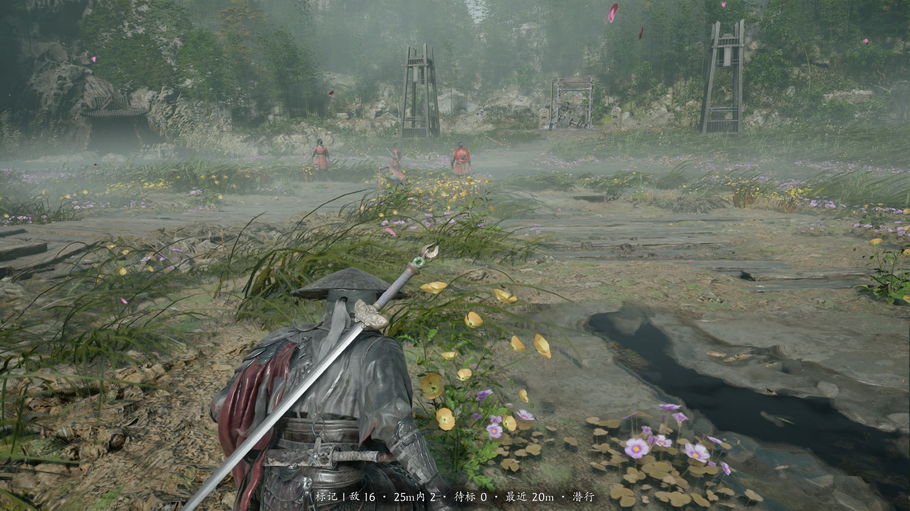
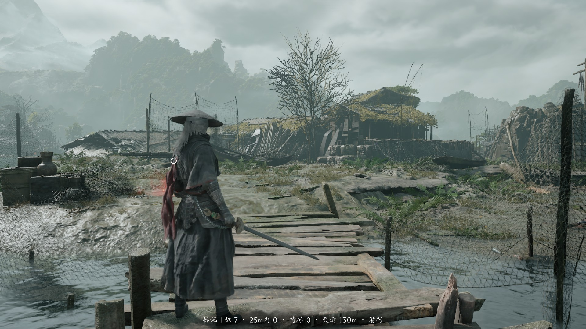

# PBZWallSense

《影之刃零》(Phantom Blade Zero) 的隔墙敌人标记模组。

跑图时，在**没进战斗**的前提下，把被墙、门、地形挡住的敌人用一枚暗红水墨环标出来——
推门进入房屋前，先知道里面有没有人。

## 效果

站在空地上，画面正下方是实时读数：当前地图共 16 个敌人、25 m 内 2 个、
待标 0 个、最近的在 20 m，状态「潜行」。



站在木栈道上，最近敌人在 130 m 外——超出锁定距离，所以不画标记，读数里也只是报数。



## 功能

- **锁定圈跟随敌人走动**：标记每帧按敌人的世界坐标重新投影，敌人跑动时圈子跟着一起走，
  被墙挡住时不会掉出画面，离开视野或被遮挡条件变化时自动淡出。
- **底部实时读数**（F8 开关），一眼看清：
  - 当前地图的**敌人数**
  - **锁定距离内的敌人数**
  - **最近敌人的距离与方位**（前 / 左前 / 左 / 左后 / 后 / 右后 / 右 / 右前）
  - 当前是「潜行」还是「战斗中」
- **锁定距离可改**：游戏内按 `[` / `]` 每次 ±5 m（10–80 m），底部读数与判定同时生效；
  也可以直接改 `CFG.maxDistCm`（默认 2500 cm = 25 m），读数里的 `25m内` 标签会自动跟着变。
- 视野内的敌人**不标**；只有被遮挡、且尚未发现你的敌人会出现标记。
- 一旦进入战斗，所有标记立即消失。
- 标记随距离缩放（20–52 px），暗红色、半透明、轻微呼吸。

## 前提

| 项 | 要求 |
|---|---|
| 游戏 | Steam 版《影之刃零》，build **26266538**（UE 5.7） |
| 模组框架 | 需要自行安装 **UE4SS 3.0.1**（[RE-UE4SS](https://github.com/UE4SS-RE/RE-UE4SS)），游戏本身**不自带** |
| 其他 | 无。不需要 Cheat Engine、不需要内存注入 |

> 游戏更新后类名可能变化，届时需要自行调整 `main.lua` 里的类名或等待更新。

## 第 1 步：安装 UE4SS（必做，游戏不自带）

本模组是 **UE4SS 的 Lua 模组**。UE4SS 不是游戏的一部分，**必须先自己装一次**，
否则后面的模组放进去也不会有任何反应（连日志都不会生成）。

> 下面所有路径里的 `<游戏目录>`，指你 Steam 里这个游戏的安装位置。
> 不知道在哪：**Steam 库 → 右键「Phantom Blade Zero」→ 管理 → 浏览本地文件**，
> 打开的窗口地址栏里那一串就是。

### 1.1 下载

打开 <https://github.com/UE4SS-RE/RE-UE4SS/releases/tag/v3.0.1>，
在页面最下面的 **Assets** 里点 **`UE4SS_v3.0.1.zip`** 下载。

> 认准 **v3.0.1**：本模组只在 3.0.1 上验证过，其他版本可能因为接口/类名变化而失效。
> 如果 3.0.1 页面上有多个 zip，选名字不带 `zDEV` 的那个。

解压后你会看到一个文件夹，里面有这 6 样东西：

```
UE4SS.dll
UE4SS-settings.ini
dwmapi.dll
Mods\                 （文件夹）
README.md
Changelog.md
```

### 1.2 摆放（关键，摆错就等于没装）

1. 进入 **`<游戏目录>\platform\steam\`** —— 这个目录里应该有 `PBZ.exe`。
2. 在这个目录里**新建一个文件夹，名字就叫 `ue4ss`**（全小写）。
3. 把解压出来的 **`UE4SS.dll`、`UE4SS-settings.ini`、`Mods` 文件夹** 三个东西，
   剪切/复制进刚建的 `ue4ss` 文件夹里。
   （`README.md`、`Changelog.md` 是说明文档，放不放都行。）
4. 把 **`dwmapi.dll`** 复制到 **`<游戏目录>\platform\steam\`** 里，
   也就是**和 `PBZ.exe` 同一个目录**（注意：它在 `ue4ss` 文件夹的**外面**）。

做完之后，目录结构必须是这样：

```
<游戏目录>\platform\steam\
├── PBZ.exe
├── dwmapi.dll          ← 从压缩包里复制到这里（和 exe 同级）
└── ue4ss\              ← 新文件夹
    ├── UE4SS.dll
    ├── UE4SS-settings.ini
    └── Mods\           ← 模组都放这里面
```

一句话记法：**`dwmapi.dll` 挨着 `PBZ.exe`，其余全部塞进 `ue4ss` 文件夹。**

> `dwmapi.dll` 是 UE4SS 的注入代理（右键 → 属性 → 详细信息，描述写着
> `UE4SS Injection Proxy`）。游戏本身没有这个文件，它也是判断"到底装没装"的标志。

### 1.3 验证装好没有

启动游戏，进到主菜单，然后**正常退出**。回到资源管理器看：

```
<游戏目录>\platform\steam\ue4ss\UE4SS.log
```

- **有这个文件** → 打开它，开头能看到 `UE4SS - v3.0.1 ...`，说明注入成功，可以继续装模组；
- **没有这个文件** → 装错了，按下面的表逐条排查，别急着装模组。

### 1.4 装不上时按这个表查

| 现象 | 原因 | 怎么办 |
|---|---|---|
| 没有 `UE4SS.log` | `dwmapi.dll` 没放在 `PBZ.exe` 旁边 | 放回 `platform\steam\` |
| 没有 `UE4SS.log` | `ue4ss` 文件夹名字/层级不对 | 必须是 `platform\steam\ue4ss\UE4SS.dll` |
| 没有 `UE4SS.log` | 杀毒软件把 `dwmapi.dll` 删了 | 加白名单后重新复制 |
| 启动就红屏 / 进不去游戏 | UE4SS 版本不适配当前游戏版本 | 删掉 `dwmapi.dll` 与 `ue4ss` 文件夹即可复原 |
| 日志里有 `Failed to load ...` | 模组放错位置或 `mods.txt` 写错 | 见下一节的"安装" |

## 第 2 步：安装本模组

1. 找到游戏的 UE4SS Mods 目录：

   ```
   <游戏安装目录>\platform\steam\ue4ss\Mods\
   ```

2. 把压缩包里的 `PBZWallSense` 文件夹**整个**复制进去，最终结构应为：

   ```
   ...\platform\steam\ue4ss\Mods\PBZWallSense\Scripts\main.lua
   ...\platform\steam\ue4ss\Mods\PBZWallSense\art\ring.png
   ...\platform\steam\ue4ss\Mods\PBZWallSense\README.md
   ```

3. 用记事本打开 **`<游戏目录>\platform\steam\ue4ss\Mods\mods.txt`**
   （就是刚才放 `PBZWallSense` 文件夹的那个位置），拉到文件最下面，
   **另起一行**写：

   ```
   PBZWallSense : 1
   ```

   注意两点：冒号**前后各一个空格**；如果最后一行没有换行，先按一次回车再写。
   保存时用默认编码即可（文件里只有英文和冒号）。

4. **重启游戏**（不要依赖热重载：`EnableHotReloadSystem` 在本作里会卡死）。

启动后日志 `platform\steam\ue4ss\UE4SS.log` 里应出现：

> 如果这个日志文件根本不存在，说明上一节的 UE4SS 没装好，模组不会加载——先回去把 UE4SS 装对。

```
Starting Lua mod 'PBZWallSense'
[PBZWallSense] 战斗状态钩子: 已注册
[PBZWallSense] 提示条内部文本控件: 已找到（直接写文本，不触发音效）
[PBZWallSense] 标记控件 = wb_damageindicator_C｜图片节点 = Image
```

## 卸载（手动，两步）

1. 从 `mods.txt` 里删掉 `PBZWallSense : 1` 那一行；
2. 删除 `Mods\PBZWallSense` 整个文件夹。

模组不修改任何游戏文件，卸载后不留残留。

## 使用

| 键 | 作用 |
|---|---|
| **F7** | 标记开 / 关 |
| **F8** | 底部读数开 / 关（再按一次关） |
| **[** | 锁定距离 −5 m |
| **]** | 锁定距离 +5 m |

锁定距离范围 10–80 m；按 `[` / `]` 后底部读数的 `25m内` 会**立刻**变成新值，不用重启。

标记出现的条件（**全部**满足）：

1. 敌人在 25 m 内、且活着；
2. 敌人没把你放进仇恨列表；
3. 你不在战斗状态；
4. 相机到敌人胸口的射线被别的东西先挡住；
5. 敌人落在屏幕内。

## 调参

参数都在 `Scripts\main.lua` 顶部的 `CFG` 表里，改完保存、重启游戏生效。

| 项 | 默认 | 说明 |
|---|---|---|
| `maxDistCm` | 2500 | 关心半径（25 m） |
| `alpha` | 0.55 | 环的不透明度 |
| `sizeMinPx` / `sizeMaxPx` | 20 / 52 | 距离缩放后的像素范围 |
| `sizeGain` | 2.6 | 距离→尺寸放大系数 |
| `tint` | `{0.78, 0.22, 0.20}` | 暗红 |
| `readoutMode` | `"tip"` | 改 `"log"` 则读数只写日志，屏幕只剩环 |
| `hideInCombat` | true | 战斗中隐藏全部标记 |
| `traceChannel` | 0 | 遮挡射线通道，打不到墙时改 1/2/3 |

## 已知限制

- 标记依赖游戏 UI 类 `wb_damageindicator_C`（目前唯一带 `Image` 节点的 HUD 控件）。若某次更新后它不再加载，标记会直接不出现。
- 退出游戏时可能生成一个 crash dump，异常码 `0xC0000005`，固定在 `UE4SS.dll`。该现象在未安装本模组时也存在，属于 UE4SS 在本作上的既有问题，不影响游戏与存档。
- 仅供单机使用。

## 许可

本项目采用 **MIT License**，详见 [LICENSE](LICENSE)。

简单说：可以自由使用、修改、分发，保留版权声明即可。这是个人作品，与游戏开发商 / 发行商无关。
